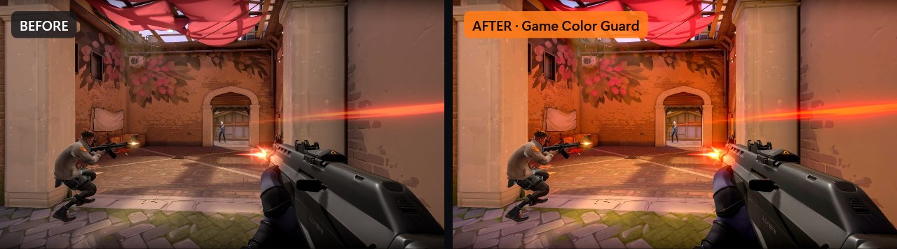
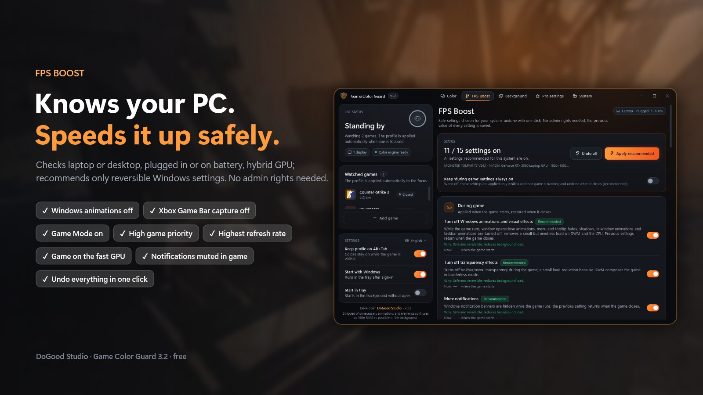
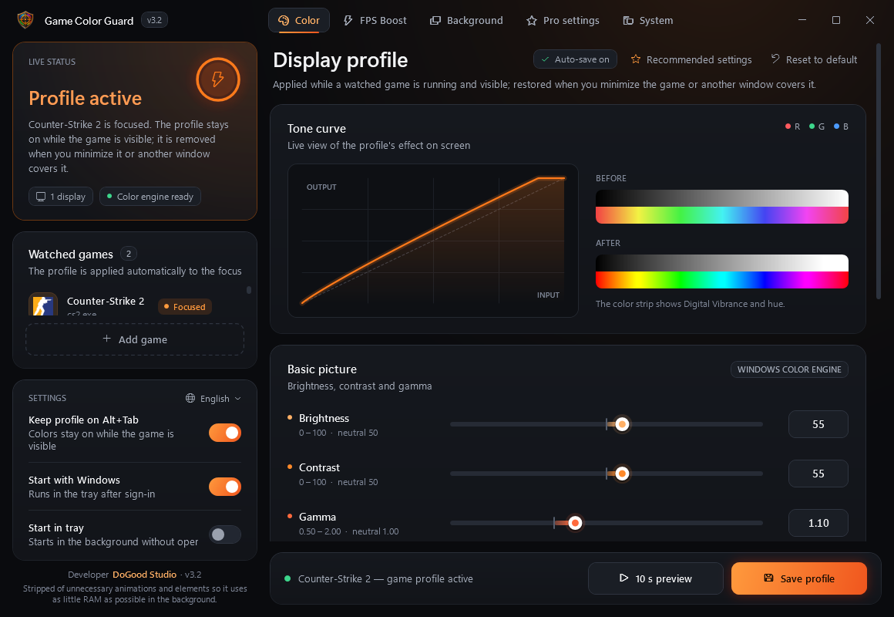

# Game Color Guard: Free FPS Booster & Digital Vibrance for CS2 and VALORANT

**Free Windows app for CS2 and VALORANT.** Boost FPS safely and make enemies easier to see with per-game **digital vibrance**, brightness, contrast and gamma. Color settings **without NVIDIA**: works on **AMD, Intel and laptops**, and doesn't reset on Alt+Tab. Also includes a background app cleaner and the settings of **200+ pro players**.

**[⬇ Download for Windows (free)](https://github.com/DoGood-Studio/game-color-guard/releases/latest/download/GameColorGuard.exe)** · [Website](https://dogood-studio.github.io/game-color-guard/en/) · [Türkçe](README.tr.md) · [VirusTotal 0/68](https://www.virustotal.com/gui/file/44f1c18d64491ca456e00fa05787360944def541aaa19cc8a85c10cf8d57fffc/detection)

**Before / after on real in-game screenshots.** Right side: brightness 55, contrast 55, gamma 1.10, vibrance 85.








## Features

### Digital Vibrance and Color Settings Without NVIDIA (AMD, Intel, Laptop)

Brightness, contrast, gamma, vibrance (saturation), hue and RGB, per game. Colors are applied through the Windows color engine instead of the graphics driver, so they work on **NVIDIA, AMD and Intel**, including **laptops with hybrid graphics** where the driver's vibrance setting often has no effect on the screen. The profile is applied only while your game is running and on screen, stays on through **Alt+Tab**, and your desktop, browser and videos keep their normal colors. An alternative to VibranceGUI and the NVIDIA Control Panel vibrance slider.

### Free FPS Booster for CS2 and VALORANT (Low-End PCs and Laptops Too)

Detects your PC (laptop or desktop, plugged in or on battery, hybrid GPU, monitor Hz) and recommends only safe Windows settings: animations and transparency off, notifications muted in game, Xbox Game Bar capture off, Game Mode on, best-performance power mode, high game priority, windowed game optimizations, highest refresh rate, and pinning the game to the high-performance GPU. Every setting is undone with one click. No admin rights.

### Best Settings for FPS and Visibility

Built-in guides for the best **CS2 settings**, **VALORANT settings** and **NVIDIA Control Panel settings** for FPS and visibility, with CS2 launch options you can copy in one click and honest notes on which tweaks actually help.

### Pro Player Settings, Configs and Crosshair Codes

Current settings of 201 pros from 37 top teams: 101 CS2 players from 19 teams and 100 VALORANT players from 18 teams (data: [prosettings.net](https://prosettings.net)). Pick by team, search, see photos and team logos. Sensitivity is converted to your mouse DPI. Load a pro's **CS2 config** in one click or copy their **VALORANT crosshair code**.

### Background App Cleaner

Lists running apps by CPU and RAM use. Only the apps you select are closed; games, anti-cheat and drivers are protected.

### System Report: Find What Is Dropping Your FPS

Read-only check with advice: single or dual-channel RAM, RAM speed and XMP, CPU power and thermal limits, P/E cores, game drive (SSD or HDD), GPU driver age, monitor Hz, Memory Integrity and HAGS.

**7 languages:** English, Türkçe, Русский, العربية, Deutsch, Español, Português. The app starts in English; switch live from the Settings card, no restart needed.

**Lightweight:** stripped of unnecessary animations and elements so it uses as little RAM as possible in the background (about 33 MB working set in the tray on Windows 11).

## Safety

- All changes are **user-level**; no admin rights.
- Every setting's previous value is saved and restored exactly when you turn it off, even after a crash.
- Windows services, `bcdedit`/HPET and VBS/Memory Integrity are **never changed**.
- The game process is never read, written or injected into. Colors change only through the Windows gamma ramp and color matrix.
- CS2 configs are written as a new `gcg_<player>.cfg` file; your own config files are never touched.

## FAQ

**Will I get banned (VAC, Vanguard, FACEIT)?**
The app never reads or writes game memory and never injects into the game. It only changes Windows display and system settings, the same level as the NVIDIA or AMD control panel. We can't speak for anti-cheat vendors, but nothing in the app touches the game itself.

**What is the AMD equivalent of digital vibrance? Does it work on AMD?**
On AMD it is called Saturation (Radeon Adrenalin). Game Color Guard works on AMD directly: it applies vibrance through Windows, so no driver setting is needed.

**Can I use digital vibrance on a laptop or with Intel graphics?**
Yes. Because Windows applies the colors, it works with Intel integrated graphics and on hybrid-graphics laptops, including the built-in screen.

**VibranceGUI is not working on my laptop, AMD or Intel PC. What can I use?**
Game Color Guard does not depend on the graphics driver, so it works where driver-based tools can't reach the screen. Run your game in borderless / windowed fullscreen.

**How do I make VALORANT more colorful or vibrant?**
Raise vibrance (NVIDIA: Digital Vibrance, AMD: Saturation) and slightly raise brightness or gamma. Game Color Guard does this per game on any GPU and only while VALORANT is on screen. Set VALORANT to windowed fullscreen.

**What is the best digital vibrance for CS2 and VALORANT?**
Most guides suggest 60–80% in the NVIDIA Control Panel, and some top players keep the default. The **Recommended settings** button applies brightness 55, contrast 55, gamma 1.10 and vibrance 85 (50 is neutral); tune it on your own monitor with the 10-second live preview.

**What are the best CS2 settings for FPS and visibility?**
Keep Boost Player Contrast on and Global Shadow Quality at Medium or higher (on Low you can't see enemy shadows); lower shader, texture and particle detail; NVIDIA Reflex on and V-Sync off. The app's CS2 guide lists these with the reasons.

**How do I fix FPS drops in CS2 and VALORANT?**
Close heavy background apps, plug in your laptop, and make sure your monitor runs at its highest Hz. The System page checks your PC for the usual causes, like single-channel RAM, a CPU at its power limit or an old GPU driver. We don't promise a fixed FPS number.

**Does digital vibrance increase FPS?**
No, it is visual only. FPS gains come from the separate FPS Boost page.

**I don't see the colors in game.**
Use **borderless / windowed fullscreen**. The color layer is not visible in exclusive fullscreen. Gamma works in both.

**Windows shows a SmartScreen warning.**
The exe is not code-signed. Click **More info › Run anyway**. The full source code is in this repository, the exe is built on GitHub with a verifiable build provenance attestation, and it is clean on [VirusTotal (0/68)](https://www.virustotal.com/gui/file/44f1c18d64491ca456e00fa05787360944def541aaa19cc8a85c10cf8d57fffc/detection).

## Download

Download `GameColorGuard.exe` from [Releases](../../releases) and run it. Single file, no installer, no .NET needed (Windows 10/11, 64-bit).

**Build provenance:** Releases are built on GitHub's servers from this repository's source and come with a build provenance attestation (since v3.2.1). Verify that your exe was built from this repository:

```
gh attestation verify GameColorGuard.exe --repo DoGood-Studio/game-color-guard
```

## Build From Source

Requires the .NET 10 SDK:

```
dotnet publish GameColorGuard.csproj -c Release -r win-x64 --self-contained true -p:PublishSingleFile=true -p:EnableCompressionInSingleFile=false -o publish
```

or run `build.cmd`. Test modes (never touch screen colors or Windows settings):

- `--render out.png [idle|active|visible|background|preview|boost|apps|pro|system] [tr|en|ru|ar|de|es|pt]` renders the UI to PNG
- `--selftest report.txt` read-only check of system detection, background scan, pro data and config generation
- `--langtest report.txt` renders every page in every language and reports untranslated text

Pro data lives in `Data/ProSettings.json` with the source page and last update of every entry; refresh it with `python tools/update_prosettings.py`. The repository contains no game logos, player photos or team logos: game icons are read from the installed game (or the game's official site), and player photos and team logos are downloaded from prosettings.net at runtime and cached in `%LocalAppData%\CS2ColorGuard\cache`. Settings and logs: `%LocalAppData%\CS2ColorGuard\`.

## License

Made by **DoGood Studio**. Licensed under [PolyForm Noncommercial 1.0.0](LICENSE): free to use, modify and share for non-commercial purposes. **It may not be sold, distributed for a fee, or included in a commercial product or service.** Keep the license text and the "Required Notice" line when sharing.

This project is not affiliated with Valve, Riot Games, NVIDIA, AMD, Intel or prosettings.net. Images: CS2 by Valve (Steam store image), VALORANT by Riot Games (official VALORANT Asset Kit). Game Color Guard isn't endorsed by Riot Games and doesn't reflect the views or opinions of Riot Games or anyone officially involved in producing or managing Riot Games properties. Riot Games, and all associated properties are trademarks or registered trademarks of Riot Games, Inc.
