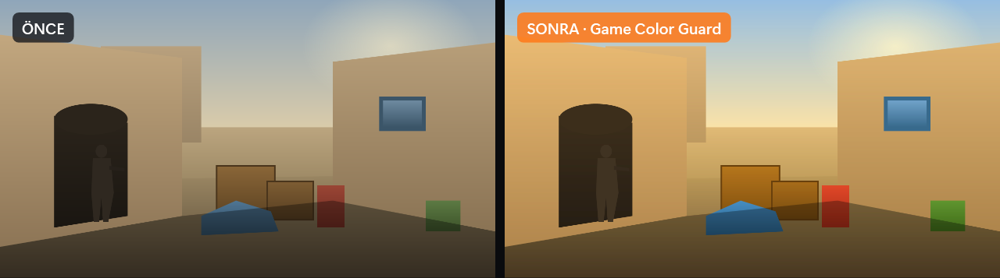

# Game Color Guard

CS2, VALORANT ve diğer rekabetçi oyunlar için Windows aracı: **oyuna özel renk profili**, **güvenli FPS Boost**, **arka plan uygulama temizliği** ve **pro oyuncu ayarları**.

*English summary below.*

**[Tanıtım sayfası ve indirme](https://ekinkocakap93.github.io/game-color-guard/)** · [Son sürüm](https://github.com/ekinkocakap93/game-color-guard/releases/latest)



*Örnek sahne kodla çizilmiştir; sağ taraf uygulamanın renk hesabının (Windows renk matrisi + gama rampası) aydınlık 55, kontrast 55, gama 1,10, canlılık 85 profiliyle uygulanmış hâlidir.*


## Özellikler

| Sayfa | Ne yapar |
|---|---|
| **Renk** | Aydınlık, kontrast, gama, Digital Vibrance, renk tonu ve RGB. İzlenen oyun açılıp ekranda göründükçe uygulanır; oyunu küçültünce ya da başka bir pencere örtünce eski hâline döner. |
| **FPS Boost** | Sistemi tanır (dizüstü/masaüstü, priz/pil, hibrit GPU, ekran Hz) ve buna göre güvenli ayarlar önerir: Windows animasyonları, saydamlık, bildirimler, Game DVR, Oyun Modu, güç modu, oyun önceliği, pencereli oyun iyileştirmeleri, en yüksek yenileme hızı, oyunu yüksek performanslı GPU'ya sabitleme. Ayrıca CS2, VALORANT ve NVIDIA Denetim Masası rehberi. |
| **Arka plan** | Çalışan uygulamaları işlemci ve RAM kullanımıyla listeler. Gruplar: önerilen / dikkat / diğer / oyun için gerekli. Yalnız sizin seçtikleriniz kapatılır. |
| **Pro ayarlar** | 21 CS2 ve 25 VALORANT top takımından 200'ü aşkın profesyonelin güncel ayarları (kaynak: [prosettings.net](https://prosettings.net)). Takıma göre seçim, arama, oyuncu fotoğrafları ve takım logoları var. Hassasiyet sizin DPI'nıza çevrilir. CS2'de tek tıkla config yükleme, VALORANT'ta crosshair kodu kopyalama. |
| **Sistem** | Donanım özeti ve öneriler: dizüstü/masaüstü, pil, RAM kanalı (tek/çift), RAM hızı/XMP ve doluluk, fiziksel çekirdek ve P/E çekirdek, işlemcinin güç/ısı sınırı, oyun diski (SSD/HDD, boş alan), GPU sürücüsünün yaşı, ekran Hz, Bellek bütünlüğü, HAGS. Bu sayfa hiçbir ayarı değiştirmez. |

## Hafiflik

Arka planda RAM kullanmaması için gereksiz animasyon ve öğelerden arındırılmıştır. Pencere tepsiye inince açılmış sayfalar ve indirilmiş görseller bırakılır, kullanılmayan bellek Windows'a geri verilir; oyun yokken süreç taraması saniyede bire düşer. Ölçüm (Windows 11, tepside): ~36 MB çalışma kümesi, ~49 MB özel bellek.

## Güvenlik ilkeleri

- Bütün ayarlar **kullanıcı düzeyindedir**; yönetici izni istenmez.
- Uygulanan her ayarın önceki değeri saklanır. Ayar kapatılınca (çökme sonrası dahil) o değere birebir dönülür. Windows zaten istenen durumdaysa hiçbir şeye dokunulmaz.
- Windows hizmetleri, `bcdedit`/HPET ve VBS/Bellek bütünlüğü **değiştirilmez**.
- Oyun süreçlerinin belleğine dokunulmaz (VAC / Vanguard / FACEIT güvenliği). Renkler yalnızca Windows'un gama rampası ve renk matrisiyle değiştirilir.
- CS2 config'i yalnızca yeni bir `gcg_<oyuncu>.cfg` dosyası olarak yazılır; mevcut config dosyalarınıza dokunulmaz.

## Kurulum

[Releases](../../releases) sayfasından `GameColorGuard.exe` dosyasını indirip çalıştırın (tek dosya, .NET kurulumu gerekmez). Exe imzalı olmadığı için ilk açılışta SmartScreen uyarısı çıkabilir.

### Kaynaktan derleme

.NET 10 SDK gerekir:

```
dotnet publish GameColorGuard.csproj -c Release -r win-x64 --self-contained true -p:PublishSingleFile=true -p:EnableCompressionInSingleFile=false -o publish
```

ya da `build.cmd`.

Test modları (ekran renklerine ve Windows ayarlarına dokunmaz):

- `GameColorGuard.exe --render çıktı.png [idle|active|visible|background|preview|boost|apps|pro|system]`: arayüzü PNG olarak çizer
- `GameColorGuard.exe --selftest rapor.txt`: sistem tanıma, arka plan taraması, pro veri ve config üretimini salt okunur doğrular

## Notlar

- Aydınlık, kontrast ve canlılık Windows renk matrisiyle (DWM) uygulanır. Bu katman **tam ekran pencereli (kenarlıksız)** modda görünür, **özel tam ekranda** görünmez. Gama, Windows gama rampasıyla uygulanır.
- Pro verileri `Data/ProSettings.json` dosyasındadır ve her kayıtta kaynak sayfa ile son güncelleme tarihi bulunur. Veriyi yenilemek için `python tools/update_prosettings.py` çalıştırın.
- Depoda hiçbir oyun logosu, oyuncu fotoğrafı ya da takım logosu yoktur. Oyun ikonları bilgisayarınızdaki oyunun exe'sinden, oyun kurulu değilse oyunun resmi sitesinden okunur. Oyuncu fotoğrafları ve takım logoları çalışırken prosettings.net'ten indirilir ve `%LocalAppData%\CS2ColorGuard\cache` altında saklanır.
- Ayarlar ve kayıtlar: `%LocalAppData%\CS2ColorGuard\` (`settings.json`, `olay.log`, `error.log`).

## English

Game Color Guard is a Windows companion for CS2, VALORANT and other competitive games. It provides a per-game color profile that stays on while the game is visible, a safe and fully reversible FPS Boost with recommendations based on your hardware, a background app cleaner that only closes what you select, one-click pro player configs (data from prosettings.net), and a read-only system report. All tweaks are user-level, need no admin rights, and are restored exactly on revert.

## Lisans ve geliştirici

Geliştirici: **DoGood Studio**.

Lisans: [PolyForm Noncommercial 1.0.0](LICENSE). Uygulamayı ücretsiz kullanabilir, değiştirebilir ve ticari olmayan amaçlarla paylaşabilirsiniz. **Satılamaz, ücretli dağıtılamaz ve ticari bir ürüne ya da hizmete dahil edilemez.** Paylaşırken lisans metnini ve "Required Notice" satırını koruyun. Bu proje Valve, Riot Games, NVIDIA veya prosettings.net ile bağlantılı değildir.
