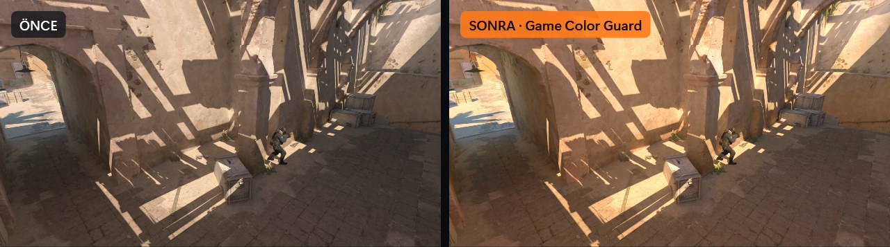
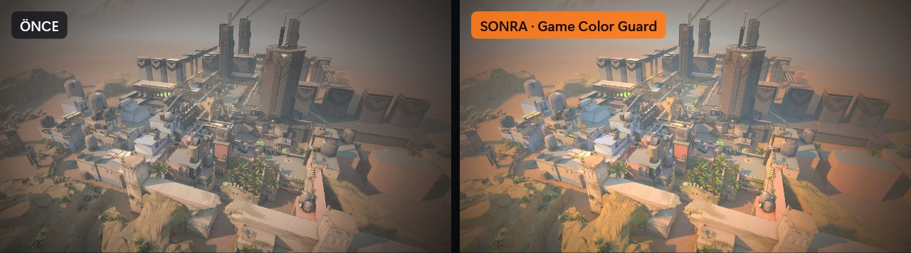
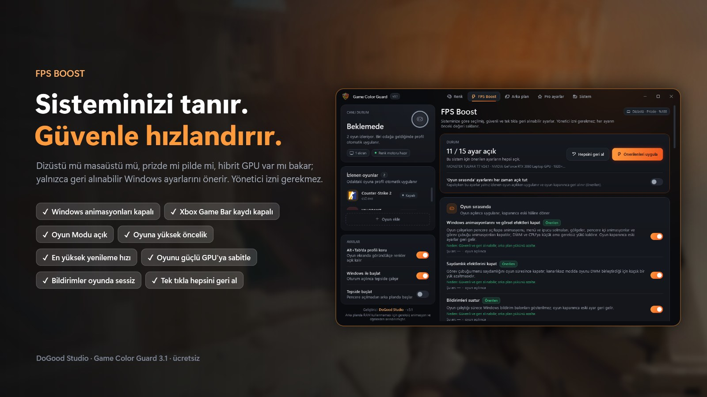

# Game Color Guard: Digital Vibrance & FPS Boost for CS2 and VALORANT

**Free Windows app that makes enemies easier to see.** Per-game **Digital Vibrance**, brightness, contrast and gamma that work on **NVIDIA, AMD, Intel and laptops**, a safe and fully reversible **FPS Boost**, a background app cleaner, and **200+ pro player settings** (CS2 configs, VALORANT crosshair codes).

**CS2 ve VALORANT'ta düşmanları daha net görmenizi sağlayan ücretsiz Windows programı.** Oyuna özel **Dijital Canlılık (Digital Vibrance)**, parlaklık, kontrast ve gama; **NVIDIA, AMD, Intel ve dizüstünde** çalışır. Güvenli **FPS artırma**, arka plan temizliği ve **200+ pro oyuncu ayarı**.

**[English](#english) · [Türkçe](#türkçe)**

**[⬇ Download for Windows / Windows İçin İndir](https://github.com/DoGood-Studio/game-color-guard/releases/latest/download/GameColorGuard.exe)** · [Website](https://dogood-studio.github.io/game-color-guard/en/) · [Tanıtım Sayfası](https://dogood-studio.github.io/game-color-guard/) · [VirusTotal 0/68](https://www.virustotal.com/gui/file/bb9d9c611562c7046f7c98d6d7e220017330859a73fc3d4e2aca7364f4280a1a/detection)

**Before / after on real in-game screenshots** (Önce / Sonra, gerçek oyun görüntüleri). Right side: brightness 55, contrast 55, gamma 1.10, vibrance 85.








---

## English

### What It Does

| Page | What It Does |
|---|---|
| **Color** | Brightness, contrast, gamma, Digital Vibrance (saturation), hue and RGB per game. Applied while your game is running and on screen; your desktop goes back to normal when you minimize or close the game. |
| **FPS Boost** | Detects your PC (laptop or desktop, plugged in or on battery, hybrid GPU, monitor Hz) and recommends safe Windows settings: animations, transparency, notifications, Game DVR, Game Mode, power mode, game priority, windowed game optimizations, highest refresh rate, and pinning the game to the high-performance GPU. Includes CS2, VALORANT and NVIDIA Control Panel guides. |
| **Background Apps** | Lists running apps by CPU and RAM use. Only the apps you select are closed; games, anti-cheat and drivers are protected. |
| **Pro Settings** | Current settings of 201 pros from 37 top teams (101 CS2 players from 19 teams, 100 VALORANT players from 18 teams; data: [prosettings.net](https://prosettings.net)). Pick by team, search, see photos and team logos. Sensitivity is converted to your mouse DPI. One-click CS2 config, copy VALORANT crosshair codes. |
| **System** | Read-only hardware report with advice: single or dual-channel RAM, RAM speed and XMP, CPU power/thermal limits, P/E cores, game drive (SSD/HDD), GPU driver age, monitor Hz, Memory Integrity, HAGS. Shows what is holding your FPS back. |

**Languages:** English, Türkçe, Русский, العربية, Deutsch, Español, Português. Switch live from the Settings card; the first launch follows your Windows language.

**Recommended settings:** One click applies DoGood Studio's color profile (brightness 55, contrast 55, gamma 1.10, vibrance 85). You can change it any time.

### Why Game Color Guard

- **Digital Vibrance on any GPU.** Colors are applied through the Windows color engine, not the graphics driver, so it works on NVIDIA, AMD and Intel, including hybrid-graphics laptops where the driver's vibrance setting often has no effect on the screen. An alternative to VibranceGUI and the NVIDIA Control Panel vibrance slider.
- **Does not reset on Alt+Tab.** The profile stays while the game is visible on screen. It is removed only when you minimize the game or another window covers it.
- **Only in game.** Your desktop, browser and videos keep their normal colors.
- **Lightweight.** Stripped of unnecessary animations and elements so it uses as little RAM as possible in the background (about 33 MB working set in the tray on Windows 11).

### Safety

- All changes are **user-level**; no admin rights.
- Every setting's previous value is saved and restored exactly when you turn it off, even after a crash.
- Windows services, `bcdedit`/HPET and VBS/Memory Integrity are **never changed**.
- The game process is never read, written or injected into. Colors change only through the Windows gamma ramp and color matrix.
- CS2 configs are written as a new `gcg_<player>.cfg` file; your own config files are never touched.

### FAQ

**Will I get banned (VAC, Vanguard, FACEIT)?**
The app never reads or writes game memory and never injects into the game. It only changes Windows display and system settings, the same level as the NVIDIA or AMD control panel. We can't speak for anti-cheat vendors, but nothing in the app touches the game itself.

**Does it work with AMD or Intel graphics?**
Yes. Colors are applied by Windows, so any GPU works, including laptops with an integrated GPU.

**What is the best digital vibrance setting for CS2?**
Most guides suggest 60–80% in the NVIDIA Control Panel, and some top players keep the default. The **Recommended settings** button applies brightness 55, contrast 55, gamma 1.10 and vibrance 85 (50 is neutral); tune it on your own monitor with the 10-second live preview.

**How do I make VALORANT more vibrant or brighter?**
Raise vibrance (NVIDIA: Digital Vibrance, AMD: Saturation) and slightly raise brightness or gamma. Game Color Guard does this per game on any GPU and only while VALORANT is on screen. Set VALORANT to windowed fullscreen.

**Does digital vibrance increase FPS?**
No, it is visual only. FPS gains come from the separate FPS Boost page.

**I don't see the colors in game.**
Use **borderless / windowed fullscreen**. The color layer is not visible in exclusive fullscreen. Gamma works in both.

**How much FPS will I gain?**
It depends on your PC. FPS Boost removes background load and sets Windows options for games. The System page tells you if something bigger is holding you back, for example single-channel RAM or a laptop running on battery.

**Windows shows a SmartScreen warning.**
The exe is not code-signed. Click **More info › Run anyway**. The full source code is in this repository and the exe is clean on [VirusTotal (0/68)](https://www.virustotal.com/gui/file/bb9d9c611562c7046f7c98d6d7e220017330859a73fc3d4e2aca7364f4280a1a/detection).

### Download

Download `GameColorGuard.exe` from [Releases](../../releases) and run it. Single file, no installer, no .NET needed (Windows 10/11, 64-bit).

**Build provenance:** From the next release on, releases are built on GitHub's servers with a build provenance attestation; v3.2 was built locally and has none. For an attested release you can verify that the exe was built from this repository:

```
gh attestation verify GameColorGuard.exe --repo DoGood-Studio/game-color-guard
```

### Build From Source

Requires the .NET 10 SDK:

```
dotnet publish GameColorGuard.csproj -c Release -r win-x64 --self-contained true -p:PublishSingleFile=true -p:EnableCompressionInSingleFile=false -o publish
```

or run `build.cmd`. Test modes (never touch screen colors or Windows settings):

- `--render out.png [idle|active|visible|background|preview|boost|apps|pro|system] [tr|en|ru|ar|de|es|pt]` renders the UI to PNG
- `--selftest report.txt` read-only check of system detection, background scan, pro data and config generation
- `--langtest report.txt` renders every page in every language and reports untranslated text

### License

Made by **DoGood Studio**. Licensed under [PolyForm Noncommercial 1.0.0](LICENSE): free to use, modify and share for non-commercial purposes. **It may not be sold, distributed for a fee, or included in a commercial product or service.** Keep the license text and the "Required Notice" line when sharing.

---

## Türkçe

### Ne Yapar

| Sayfa | Ne Yapar |
|---|---|
| **Renk** | Oyuna özel parlaklık (aydınlık), kontrast, gama, Dijital Canlılık (Digital Vibrance), renk tonu ve RGB. İzlenen oyun açık ve ekranda göründükçe uygulanır; oyunu küçültünce ya da kapatınca masaüstü eski hâline döner. |
| **FPS Boost** | Bilgisayarınızı tanır (dizüstü/masaüstü, priz/pil, hibrit GPU, ekran Hz) ve buna göre güvenli FPS artırma ayarları önerir: Windows animasyonları, saydamlık, bildirimler, Game DVR, Oyun Modu, güç modu, oyun önceliği, pencereli oyun iyileştirmeleri, en yüksek yenileme hızı, oyunu yüksek performanslı GPU'ya sabitleme. CS2, VALORANT ve NVIDIA Denetim Masası rehberi de var. |
| **Arka Plan** | Çalışan uygulamaları işlemci ve RAM kullanımıyla listeler. Yalnız sizin seçtikleriniz kapatılır; oyun, anti-hile ve sürücüler korunur. |
| **Pro Ayarlar** | 37 top takımdan 201 profesyonelin güncel ayarları (19 takımdan 101 CS2, 18 takımdan 100 VALORANT oyuncusu; kaynak: [prosettings.net](https://prosettings.net)). Takıma göre seçim, arama, oyuncu fotoğrafları ve takım logoları var. Hassasiyet sizin fare DPI'nıza çevrilir. CS2'de tek tıkla config yükleme, VALORANT'ta crosshair kodu kopyalama. |
| **Sistem** | Salt okunur donanım raporu ve öneriler: RAM tek/çift kanal, RAM hızı ve XMP, işlemcinin güç/ısı sınırı, P/E çekirdek, oyun diski (SSD/HDD), GPU sürücüsünün yaşı, ekran Hz, Bellek bütünlüğü, HAGS. FPS'inizi neyin kıstığını söyler. |

**Diller:** Türkçe, English, Русский, العربية, Deutsch, Español, Português. Dil, Ayarlar kartındaki seçiciden yeniden başlatmadan değişir; ilk açılışta Windows dili kullanılır.

**Önerilen ayarlar:** Tek tıkla DoGood Studio'nun renk profilini uygular (aydınlık 55, kontrast 55, gama 1,10, canlılık 85). Sonra istediğiniz gibi değiştirebilirsiniz.

### Neden Game Color Guard

- **Her ekran kartında Dijital Canlılık.** Renkler ekran kartı sürücüsüyle değil Windows'un renk motoruyla uygulanır. NVIDIA, AMD ve Intel'de, sürücünün canlılık ayarının ekrana yansımadığı hibrit grafikli dizüstülerde bile çalışır. VibranceGUI'ye ve NVIDIA Denetim Masası'ndaki canlılık ayarına bir alternatiftir.
- **Alt+Tab'da sıfırlanmaz.** Oyun ekranda göründükçe profil korunur; yalnız oyunu küçültünce ya da başka bir pencere örtünce kalkar.
- **Sadece oyunda.** Masaüstünüz, tarayıcınız ve videolarınız normal renklerinde kalır.
- **Hafif.** Arka planda RAM kullanmaması için gereksiz animasyon ve öğelerden arındırılmıştır. Ölçüm (Windows 11, tepside): yaklaşık 33 MB çalışma kümesi, 49 MB özel bellek.

### Güvenlik İlkeleri

- Bütün ayarlar **kullanıcı düzeyindedir**; yönetici izni istenmez.
- Uygulanan her ayarın önceki değeri saklanır. Ayar kapatılınca (çökme sonrası dahil) o değere birebir dönülür. Windows zaten istenen durumdaysa hiçbir şeye dokunulmaz.
- Windows hizmetleri, `bcdedit`/HPET ve VBS/Bellek bütünlüğü **değiştirilmez**.
- Oyun süreçlerinin belleğine dokunulmaz (VAC / Vanguard / FACEIT). Renkler yalnızca Windows'un gama rampası ve renk matrisiyle değiştirilir.
- CS2 config'i yalnızca yeni bir `gcg_<oyuncu>.cfg` dosyası olarak yazılır; mevcut config dosyalarınıza dokunulmaz.

### Sık Sorulan Sorular

**Ban yer miyim (VAC, Vanguard, FACEIT)?**
Program oyunun belleğini okumaz, yazmaz ve oyuna enjekte olmaz. Yalnız Windows'un ekran ve sistem ayarlarını değiştirir; NVIDIA veya AMD denetim masasıyla aynı seviyededir. Anti-hile şirketleri adına konuşamayız, ama program oyunun kendisine hiç dokunmaz.

**AMD veya Intel ekran kartında çalışır mı?**
Evet. Renkleri Windows uyguladığı için her ekran kartında, dahili GPU'lu dizüstülerde de çalışır.

**CS2'de düşmanlar nasıl daha net görünür?**
Dijital canlılığı ve gamayı biraz artırın; oyun içinde "Oyuncu Kontrastını Artır"ı açın ve "Global Gölge Kalitesi"ni en az Orta tutun (düşükte rakip gölgelerini göremezsiniz). Program bu oyun içi ayarların rehberini de içerir.

**Dijital canlılık kaç olmalı?**
Rehberlerin çoğu NVIDIA Denetim Masası'nda %60–80 öneriyor; bazı profesyoneller varsayılanda bırakıyor. **Önerilen ayarlar** düğmesi aydınlık 55, kontrast 55, gama 1,10, canlılık 85 uygular (50 nötr). 10 saniyelik canlı önizlemeyle kendi monitörünüze göre ayarlayın.

**Dijital canlılık FPS artırır mı?**
Hayır, yalnız görüntüyü etkiler. FPS kazancı ayrı FPS Boost sayfasından gelir.

**Oyunda renkleri göremiyorum.**
Oyunu **tam ekran pencereli (kenarlıksız)** modda açın. Renk katmanı özel tam ekranda görünmez; gama iki modda da çalışır.

**Ne kadar FPS artar?**
Bilgisayarınıza bağlıdır. FPS Boost arka plan yükünü azaltır ve Windows'u oyun için ayarlar. Sistem sayfası, FPS'i asıl kısan şey varsa söyler: örneğin tek kanal RAM ya da pilde çalışan dizüstü.

**SmartScreen uyarısı çıkıyor.**
Exe dijital imzalı olmadığı için ilk açılışta çıkabilir: **Ek bilgi › Yine de çalıştır**. Kaynak kodun tamamı bu depoda; exe [VirusTotal'da 0/68](https://www.virustotal.com/gui/file/bb9d9c611562c7046f7c98d6d7e220017330859a73fc3d4e2aca7364f4280a1a/detection) temiz çıktı (24 Ekim 2026).

### Kurulum

[Releases](../../releases) sayfasından `GameColorGuard.exe` dosyasını indirip çalıştırın. Tek dosyadır, kurulum ya da .NET gerektirmez (Windows 10/11, 64 bit).

**Derleme kanıtı:** Bundan sonraki sürümler GitHub'ın sunucusunda derlenip derleme kanıtıyla (build provenance attestation) yayınlanır; v3.2 elle derlendiği için kanıtı yoktur. Kanıtlı bir sürümde indirdiğiniz exe'nin bu depodaki koddan üretildiğini kendiniz doğrulayabilirsiniz:

```
gh attestation verify GameColorGuard.exe --repo DoGood-Studio/game-color-guard
```

### Kaynaktan Derleme

.NET 10 SDK gerekir:

```
dotnet publish GameColorGuard.csproj -c Release -r win-x64 --self-contained true -p:PublishSingleFile=true -p:EnableCompressionInSingleFile=false -o publish
```

ya da `build.cmd`. Test modları (ekran renklerine ve Windows ayarlarına dokunmaz):

- `--render çıktı.png [idle|active|visible|background|preview|boost|apps|pro|system] [tr|en|ru|ar|de|es|pt]`: arayüzü PNG olarak çizer
- `--selftest rapor.txt`: sistem tanıma, arka plan taraması, pro veri ve config üretimini salt okunur doğrular
- `--langtest rapor.txt`: her dilde bütün sayfaları çizer, çevrilmeden kalan metni raporlar (canlı dil değişimi dahil)

### Notlar

- Pro verileri `Data/ProSettings.json` dosyasındadır; her kayıtta kaynak sayfa ve son güncelleme tarihi bulunur. Veriyi yenilemek için `python tools/update_prosettings.py` çalıştırın.
- Depoda hiçbir oyun logosu, oyuncu fotoğrafı ya da takım logosu yoktur. Oyun ikonları bilgisayarınızdaki oyunun exe'sinden, oyun kurulu değilse oyunun resmi sitesinden okunur. Oyuncu fotoğrafları ve takım logoları çalışırken prosettings.net'ten indirilir ve `%LocalAppData%\CS2ColorGuard\cache` altında saklanır.
- Ayarlar ve kayıtlar: `%LocalAppData%\CS2ColorGuard\` (`settings.json`, `olay.log`, `error.log`).

### Lisans ve Geliştirici

Geliştirici: **DoGood Studio**. Lisans: [PolyForm Noncommercial 1.0.0](LICENSE). Uygulamayı ücretsiz kullanabilir, değiştirebilir ve ticari olmayan amaçlarla paylaşabilirsiniz. **Satılamaz, ücretli dağıtılamaz ve ticari bir ürüne ya da hizmete dahil edilemez.** Paylaşırken lisans metnini ve "Required Notice" satırını koruyun.

---

This project is not affiliated with Valve, Riot Games, NVIDIA, AMD, Intel or prosettings.net. Bu proje Valve, Riot Games, NVIDIA, AMD, Intel veya prosettings.net ile bağlantılı değildir. Images: CS2 by Valve (Steam store image), VALORANT by Riot Games (official VALORANT Asset Kit). Game Color Guard isn't endorsed by Riot Games and doesn't reflect the views or opinions of Riot Games or anyone officially involved in producing or managing Riot Games properties. Riot Games, and all associated properties are trademarks or registered trademarks of Riot Games, Inc.
